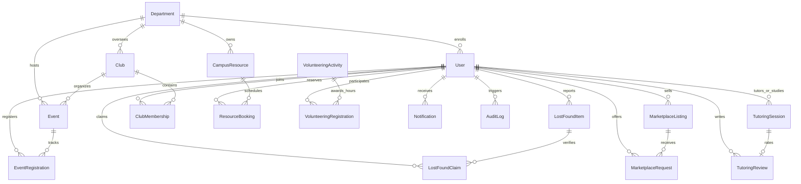

# CampusSphere — Smart Campus Community & Collaboration Platform

> **Tagline:** *One Campus. One Community. Endless Possibilities.*

CampusSphere is a centralized digital ecosystem engineered for higher education institutions. It connects students, faculty, club coordinators, resource managers, and campus administrators into a unified platform for events, lost-and-found matching, peer marketplaces, skill-sharing tutoring, clubs, community service volunteering, and facility booking.

---

## 1. System Architecture & Entity Relationship Diagram

### 1.1 Technology Stack

| Layer | Technologies |
| :--- | :--- |
| **Frontend** | React 18, Vite, Material UI (MUI v5/v6), Emotion, React Router v6, Axios, Recharts, Socket.IO Client |
| **Backend** | Node.js, Express.js (ES Modules), Socket.IO, Multer, Helmet, Morgan, Express Rate Limit |
| **Database** | MongoDB with Mongoose ODM (21 normalized schemas with compound indexes & validation) |
| **Authentication** | JWT (JSON Web Tokens), bcryptjs password hashing, server-enforced RBAC |
| **Testing** | Vitest, Supertest, React Testing Library, JSDOM |
| **Deployment** | Vercel (Frontend SPA), Render (Backend Node API), MongoDB Atlas |

---

### 1.2 Mermaid Entity-Relationship (ER) Diagram



---

## 2. User Roles & Server-Enforced RBAC

CampusSphere enforces strict, server-side Role-Based Access Control (RBAC). Roles are never trusted from client-side state.

| Role | Permissions & Scope |
| :--- | :--- |
| **Student** | Discover and register for events (with atomic waitlists), report lost/found items, file ownership claims, list marketplace goods, request exchanges, book tutoring, join clubs, reserve permitted resources, track verified volunteering hours. |
| **Faculty** | Publish official academic announcements, organize campus events, supervise volunteering drives, verify community service hours, view department metrics. |
| **Club Coordinator** | Manage assigned club profiles, review membership applications, assign committee roles (e.g. PR Lead, Treasurer), host club hackathons/events. |
| **Resource Manager** | Manage campus halls, labs, and equipment. Configure operating hours, inspect conflict detection, approve or reject booking reservations. |
| **Campus Administrator** | Full platform governance, user activation/suspension, content moderation for flagged posts, compliance audit log inspection, campus-wide analytics. |

---

## 3. Core Modules Overview

### 1. Campus Events & Attendance (`/events`)
- Atomic capacity enforcement with automatic waitlist queueing.
- Automatic waitlist promotion when confirmed seats are cancelled.
- Unique 6-character check-in PIN code for verified participant attendance.

### 2. Lost & Found Matching (`/lost-found`)
- Deterministic matching algorithm scoring candidate items based on Category (35%), Color (15%), Date Proximity (20%), Location overlap (15%), and Keyword overlap (15%).
- Private proof-of-ownership claim verification (serial numbers, wallpapers, and markings are kept strictly confidential).

### 3. Student Marketplace & Item Exchange (`/marketplace`)
- Student exchange for textbooks, graphing calculators, lab coats, and electronics.
- Negotiation threads for buy or exchange offers.
- Handover status tracking without false payment gateway claims.

### 4. Peer Tutoring & Skill Sharing (`/tutoring`)
- Subject mentor profiles with weekly availability slots.
- Anti-double-booking validation preventing overlapping slots and past dates.
- Verified 5-star reviews restricted exclusively to students who attended completed sessions.

### 5. Clubs & Societies (`/clubs`)
- Club discovery with categories (Technical, Cultural, Sports, Arts).
- Application and coordinator approval workflows.
- Coordinator committee role assignment.

### 6. Announcements & Real-Time Alerts (`/announcements`, `/notifications`)
- Target audience broadcasting: Campus-wide, Department, Club, or Role.
- Pinned emergency banners and expiration date filtering.
- Persistent MongoDB notifications delivered live via authenticated Socket.IO rooms.

### 7. Resource Booking & Conflict Guard (`/bookings`)
- Rooms, engineering labs, and 4K projection kits with operating hours.
- Server-side validation preventing overlapping approved bookings for the same resource.

### 8. Volunteering & Community Service (`/volunteering`)
- Community service drives with verified supervisor hours.
- Downloadable/printable participation certificate generator with unique verification codes.

### 9. Campus Analytics & Moderation (`/analytics`, `/admin`)
- Aggregated real-time metrics using MongoDB aggregation pipelines (`$group`, `$match`).
- Recharts visualizations (Bar, Pie, Line) and one-click CSV report export.
- Administrative content moderation queue and security audit trail.

---

## 4. Demo Accounts for Immediate Testing

The database seeding script pre-populates 5 role-specific demonstration accounts:

| Role | Email | Password | Primary Features to Test |
| :--- | :--- | :--- | :--- |
| **Student** | `student@campussphere.edu` | `Student@123` | Event registration, PIN check-in, Marketplace listing, Tutoring request, Volunteering records |
| **Student 2** | `student2@campussphere.edu` | `Student@123` | Peer counterparty for marketplace offers, peer tutoring sessions |
| **Campus Admin** | `admin@campussphere.edu` | `Admin@123` | User suspension/activation, content moderation, audit logs, campus analytics |
| **Faculty** | `faculty@campussphere.edu` | `Faculty@123` | Create announcements, supervise volunteering, verify student hours |
| **Club Coordinator** | `coordinator@campussphere.edu` | `Coordinator@123` | Manage ACM Student Chapter, review memberships, assign committee roles |
| **Resource Manager** | `resourcemanager@campussphere.edu` | `Manager@123` | Review room and lab reservations, prevent schedule conflicts |

> *Tip: On both the Landing page and Login page, you can use the **1-Click Demo Buttons** to instantly authenticate without manual typing.*

---

## 5. Local Setup & Installation

### Prerequisites
- **Node.js**: v18.0.0 or higher (v22 tested)
- **MongoDB**: Local MongoDB server running on port 27017 or a MongoDB Atlas URI
- **Git**

### Step 1: Clone and Install Dependencies
```bash
git clone https://github.com/your-username/CampusSphere.git
cd CampusSphere

# Install all dependencies across root, server, and client:
npm run install:all
```

### Step 2: Configure Environment Variables
Copy `.env.example` in `server/.env`:
```bash
# Server configuration
PORT=5000
NODE_ENV=development
CLIENT_URL=http://localhost:5173
MONGODB_URI=mongodb://127.0.0.1:27017/campussphere
JWT_SECRET=super_secure_jwt_secret_key_campussphere_2026_dev
JWT_EXPIRES_IN=7d
UPLOAD_DIR=uploads
MAX_FILE_SIZE_MB=5
ALLOWED_EMAIL_DOMAIN=campussphere.edu
REQUIRE_CAMPUS_EMAIL=false
```

### Step 3: Seed the Database
Run the repeatable database seeding script to populate departments, demo users, events, marketplace items, resources, and clubs:
```bash
npm run seed
```

### Step 4: Start the Development Server
```bash
# Starts both Express backend (Port 5000) and Vite frontend (Port 5173) concurrently:
npm run dev
```

Visit **`http://localhost:5173`** in your browser.

---

## 6. Running Automated Tests & Production Build

### Backend Tests (Vitest + Supertest)
```bash
npm --prefix server test
```
*Validates health check, JWT authentication, bcrypt password hashing, RBAC route blocks, event capacity queries, and analytics aggregation.*

### Frontend Tests (Vitest + React Testing Library)
```bash
npm --prefix client test
```

### Frontend Production Build
```bash
npm run build
```

---

## 7. API Reference Summary

All endpoints are hosted under `/api` and return standardized responses:
```json
{
  "success": true,
  "message": "Operation completed successfully",
  "data": {}
}
```

- `POST /api/auth/register` — Register a student account
- `POST /api/auth/login` — Authenticate and receive JWT
- `GET /api/auth/me` — Get authenticated user profile
- `GET /api/dashboard` — Get student personalized dashboard
- `GET /api/events` — Browse events with category and date filters
- `POST /api/events/:id/register` — Register with atomic capacity check
- `POST /api/events/:id/cancel` — Cancel registration and trigger waitlist promotion
- `POST /api/events/:id/checkin` — Verify attendance with 6-digit PIN
- `GET /api/lost-found` — Browse lost and found reports
- `POST /api/lost-found/:id/claim` — Submit private proof-of-ownership claim
- `PATCH /api/lost-found/claims/:claimId` — Approve or reject ownership claim
- `GET /api/marketplace` — Browse peer marketplace listings
- `POST /api/marketplace/:id/request` — Submit buy or exchange proposal
- `PATCH /api/marketplace/requests/:requestId` — Accept/complete handover
- `GET /api/tutors` — Search peer tutors by subject and rating
- `POST /api/tutors/request` — Book session with anti-double-booking check
- `POST /api/tutors/sessions/:sessionId/review` — Submit verified participant review
- `GET /api/clubs` — Browse student organizations
- `POST /api/clubs/:id/apply` — Apply for club membership
- `PATCH /api/clubs/memberships/:membershipId` — Approve or reject membership
- `GET /api/resources` — List campus halls, labs, and equipment
- `POST /api/resources/book` — Request reservation with conflict guard
- `PATCH /api/resources/bookings/:bookingId/review` — Resource manager approval
- `GET /api/volunteering` — Browse community service opportunities
- `PATCH /api/volunteering/registrations/:id/verify` — Award verified hours & certificate
- `GET /api/analytics` — Fetch aggregated metrics
- `GET /api/analytics/export-csv` — Export events analytics as CSV
- `GET /api/admin/users` — Administrator user directory
- `PATCH /api/admin/users/:id` — Suspend or reactivate user accounts

---

## 8. Deployment Readiness

### Frontend (Vercel)
1. Push repository to GitHub.
2. Import project into Vercel and select root directory as `client`.
3. Set Build Command to `npm run build` and Output Directory to `dist`.
4. Configure environment variable: `VITE_API_URL=https://your-backend.onrender.com`.

### Backend (Render)
1. Create a Web Service on Render pointing to the `server` directory.
2. Build Command: `npm install`.
3. Start Command: `npm start`.
4. Add environment variables: `MONGODB_URI`, `JWT_SECRET`, `CLIENT_URL`.

---

## 9. License & Academic Attribution
Developed as an enterprise-grade full-stack demonstration for final-year engineering projects. MIT Licensed.
